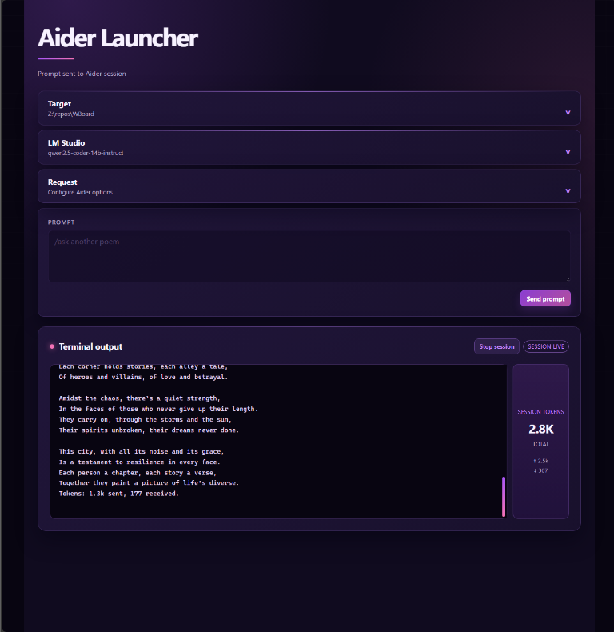

# Aider UI

Aider UI is a local web interface for interacting with the Aider tool. It provides functionalities such as handling JSON responses, streaming events, and managing sessions.



## Features

- **JSON Response Handling**: Easily handle JSON data from different sources.
- **Event Streaming**: Stream real-time events to subscribers.
- **Session Management**: Manage user sessions efficiently.
- **Model Interaction**: Interact with models through API endpoints.
- **Directory Resolution**: Resolve directories and their contents.
- **Token Normalization**: Normalize tokens for better management.

## Usage

1. Clone the repository:
   ```bash
   git clone https://github.com/yourusername/aider-ui.git
   ```

2. Navigate to the project directory:
   ```bash
   cd aider-ui
   ```

3. Install dependencies:
   ```bash
   pip install -r requirements.txt
   ```

4. Run the application:
   ```bash
   python backend/run_Aider.py
   ```

## Contributing

Contributions are welcome! Please follow these guidelines:

1. Fork the repository.
2. Create a new branch for your feature or bug fix.
3. Commit your changes.
4. Push to your forked repository.
5. Open a pull request.

## License

This project is licensed under the MIT License. See the [LICENSE](LICENSE) file for details.
