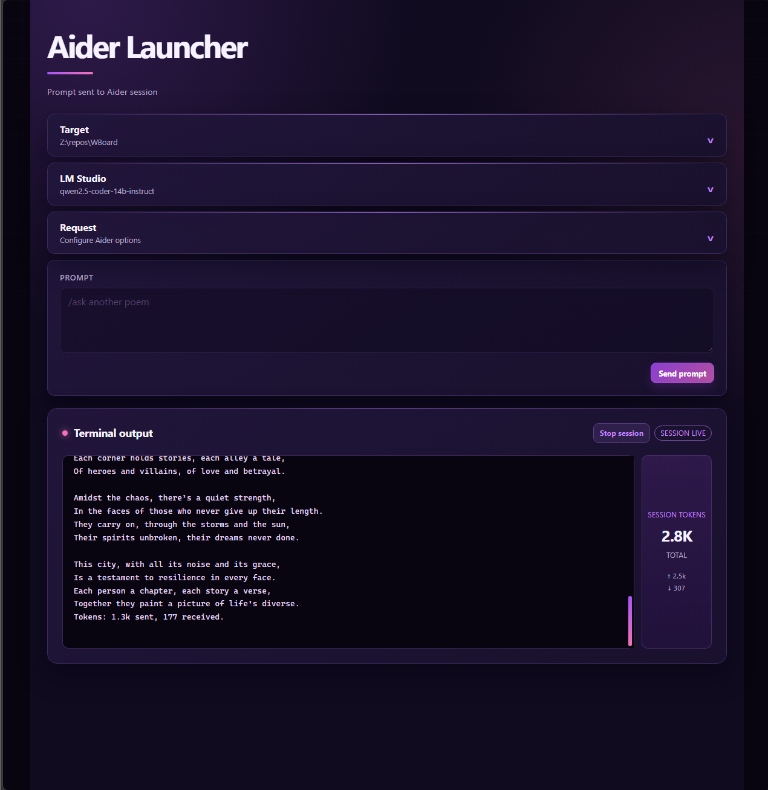

# Aider Wrapper

Aider Wrapper is a local web interface and VS Code extension for interacting with the Aider tool. It provides model configuration, directory browsing, streaming output, and reusable Aider sessions.



## Features

- **JSON Response Handling**: Easily handle JSON data from different sources.
- **Event Streaming**: Stream real-time events to subscribers.
- **Session Management**: Manage user sessions efficiently.
- **Model Interaction**: Interact with models through API endpoints.
- **Directory Resolution**: Resolve directories and their contents.
- **Token Normalization**: Normalize tokens for better management.

## Browser usage

1. Clone the repository:
   ```bash
   git clone https://github.com/yourusername/aider-ui.git
   ```

2. Navigate to the project directory:
   ```bash
   cd aider-ui
   ```

3. Install dependencies:
   ```bash
   pip install -r requirements.txt
   ```

4. Run the application:
   ```bash
   python backend/run_Aider.py
   ```

## VS Code extension

1. Build the bundled webview:
   ```bash
   npm install
   npm run build
   ```
2. Open this folder in VS Code and press `F5` to launch an Extension Development Host.
3. Click the **Aider Wrapper** icon in the Activity Bar. The Aider panel opens in the side panel.

You can also run **Aider Wrapper: Open** from the Command Palette.

The extension starts the Python backend on a private localhost port and hosts the built React UI in a VS Code webview. Set `aiderWrapper.pythonPath` if `python` is not on your PATH.

## Contributing

Contributions are welcome! Please follow these guidelines:

1. Fork the repository.
2. Create a new branch for your feature or bug fix.
3. Commit your changes.
4. Push to your forked repository.
5. Open a pull request.

## License

This project is licensed under the MIT License. See the [LICENSE](LICENSE) file for details.
